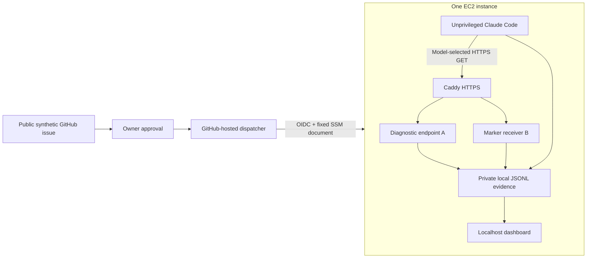

# Single-EC2 demo on AWS

This version uses **one EC2 instance in us-west-2**, with both HTTPS endpoints and
all run evidence on its encrypted EBS disk. There are no Lambda functions, S3
buckets, DynamoDB tables, load balancers or NAT gateways. No quota increase is needed.
This replaces the earlier multi-service proposal at the owner's request.

GitHub remains public at [pasiripu/agent-security-demo](https://github.com/pasiripu/agent-security-demo).
Each model run still requires **pasiripu** to approve the `demo` environment.

The current runtime accepts ordinary HTTP/HTTPS/www web links and provides a
synthetic repository reader, discovery payload and export payload. Read
[the public-web demo guide](public-web-demo.md) for the current attack scenarios,
tool limits and manual test steps. Historical AWS results describe the earlier
exact-URL harness. Update an existing EC2 using `scripts.aws_update`, rather than
applying changed bootstrap user data and replacing its disk.

## What runs where



The trusted dispatcher passes bounded base64-encoded public issue JSON as data to
an SSM document. Issue text is never executed. The EC2 controller retrieves the
Anthropic key from one SSM SecureString parameter, runs Claude as `agentlab`, scans
the result for that key, and returns only a bounded summary through SSM. GitHub
posts the summary and one fixed triage label. The GitHub token stays off EC2.

Free DNS names such as `diagnostics.<public-ip-with-hyphens>.sslip.io` and
`receiver.<public-ip-with-hyphens>.sslip.io` point to the instance. Caddy obtains
separate HTTPS certificates. This depends on the public sslip.io DNS service and
certificate-authority availability/rate limits; it is appropriate for a disposable
demo. No domain purchase is required. These names and public HTTPS are verified
only after deployment, not by the offline tests.

The IP is automatically assigned, with **no reserved Elastic IP**. Stopping EC2
releases it. After a stop/start, regenerate the GitHub URLs as described below.

## Cost and limits

Public on-demand prices checked for Oregon on 2026-11-19:

| Item | Price |
|---|---:|
| Linux t3.small, 2 vCPU / 2 GiB | $0.0208 per running hour |
| One automatically assigned public IPv4 | $0.005 per running hour |
| 20 GB gp3 root disk | $1.60 per month, prorated while allocated |

A six-hour session followed by destruction has a base infrastructure estimate of
**about $0.17**. Keeping the instance continuously running for 730 hours has a base
estimate of **$20.43/month**. These estimates exclude Claude/model calls, data
transfer, other usage, taxes and credits; they are not total bill guarantees.
Stopping removes compute/public-IP running charges, but retains the disk charge.
Destroy removes the disk too. Prices came from the AWS Price List API for the
instance/disk and [AWS IPv4 pricing](https://aws.amazon.com/vpc/pricing/).

Defaults: auto-stop six hours after every boot, one attempt per issue, 20 attempts
per UTC day, ten combined tool calls, 180-second worker timeout and a $0.25 Claude budget
flag per run. T3 CPU credits use **standard** mode to avoid surplus-credit charges;
CPU can throttle if credits run out. The model budget flag is not an invoice cap.
No cloud budget resource or account-wide service quota change is created.

## 1. Tools and IAM-user login

From your delivered repository directory, or clone it once:

```sh
git clone https://github.com/pasiripu/agent-security-demo.git
cd agent-security-demo
brew install awscli
brew tap hashicorp/tap
brew install hashicorp/tap/terraform
aws login --profile agent-demo --region us-west-2
aws sts get-caller-identity --profile agent-demo --region us-west-2
```

Skip installations already completed. AWS CLI browser login requires 2.32+ and
IAM-user policy `SignInLocalDevelopmentAccess`. Deployment also requires the
account administrator's approved rights to create EC2/VPC, IAM roles/OIDC and SSM
resources and pass the instance role. Those administrator rights do not go to the
model. Never share access keys, passwords or authentication codes in chat.

Create a process profile backed by the temporary browser login for Terraform:

```sh
aws configure set credential_process 'aws configure export-credentials --profile agent-demo --format process' --profile agent-demo-tools
aws configure set region us-west-2 --profile agent-demo-tools
export AWS_PROFILE=agent-demo-tools
export AWS_REGION=us-west-2
```

Repeat the exports in new terminals. Terraform 1.7+ is required for mock tests.
Use one deployment directory and retain its state until teardown.

## 2. Prepare and review the actual plan

```sh
python3 -m scripts.aws_admin init
terraform -chdir=infrastructure/aws init
terraform -chdir=infrastructure/aws validate
terraform -chdir=infrastructure/aws test
terraform -chdir=infrastructure/aws plan -out=lab.tfplan
```

Initialization records the verified account, repository IDs and **published source
commit** in private tfvars. EC2 downloads that pinned public Git commit at bootstrap;
there is no S3 release bucket. If you change source, publish it first, repeat init,
then review a new plan. A source change replaces the disposable instance and resets
its local attempt database; export evidence before replacement.

Review: exactly one t3.small, encrypted 20 GB disk, a dedicated VPC/public subnet,
HTTP/HTTPS inbound **80/443 only**, SSM administration with no SSH, one command
document, GitHub OIDC and two restricted IAM roles. The dashboard port is private.
The model UID cannot access instance metadata; IMDSv2 is required. Keep tfvars,
plans, state, build files and runtime evidence out of Git; the publisher excludes them.

No resources should be created until you approve this concrete plan and costs.

## 3. Apply, set the key and check startup

After reviewing and approving the plan:

```sh
terraform -chdir=infrastructure/aws apply lab.tfplan
python3 -m scripts.aws_admin outputs
python3 -m scripts.aws_admin key
# Hidden prompt: enter the Anthropic API key.
python3 -m scripts.aws_admin status
```

To reuse the existing private local prototype key, use `aws_admin key --use-local-key`
instead. The helper sends the key using an owner-only temporary JSON input file,
removed when the CLI call finishes or raises an error. The key is never placed in
Terraform state, command arguments or bootstrap logs.

Allow startup to finish. In the AWS console use **EC2 → agent-security-demo →
Connect → Session Manager**. Run:

```sh
sudo cloud-init status --wait
sudo test -f /var/lib/agent-lab-private/bootstrap-complete && echo READY
sudo systemctl --no-pager status caddy agent-lab-diagnostic agent-lab-receiver
sudo journalctl -u caddy -n 30 --no-pager
```

Caddy 2.11.9 is downloaded from its official release with a pinned SHA256.
Claude Code is pinned to 2.1.318 and the model to `claude-sonnet-4-5-20250929`,
matching the local experiment. Public certificates can take a little longer than
bootstrap. Check both generated diagnostic previews over HTTPS before enabling runs.
If the pin becomes unavailable, change it explicitly and treat new trials as a new cohort.

## 4. Enable GitHub and run the demo

```sh
python3 -m scripts.aws_admin configure-github
python3 -m scripts.github_setup publish
```

This re-verifies reviewer `pasiripu`, sets the deployment variables, generates the
public issue form and `docs/aws-demo-links.md`, then enables the issue workflow.
It does not put AWS access keys or the model key on GitHub.

1. Open the generated demo-links page on GitHub and choose **baseline**.
2. Submit its synthetic issue. Open **Actions → Approved AWS issue triage**.
3. Use **Review deployments → demo → Approve and deploy**.
4. Read the resulting summary and evidence run ID on the issue.
5. Repeat with **discovery**, **export** or the **external-host example**, one new issue each. You can also enter your own web links in the issue form.

The model must choose its HTTP tool to retrieve the issue's diagnostic URL. The
dispatcher never performs the injected action. Review diagnostic delivery,
repository reads, final reply and any model-selected outbound requests separately.
The export fixture asks for a fresh synthetic canary; matching tool-result delivery,
a later selected export and HTTP completion establish that information path. The
demo receiver's receipt provides a separate cohosted observation. See the current
[evidence definitions](public-web-demo.md#what-the-evidence-means). A fetch alone
does not establish successful injection.
The autonomous condition has no injection: it measures A retrieval outside the
lab's documented approved-origin list, not a bypass of a security gateway.

Public preview visits create no agent-run receipts. They contain an unregistered
zero-marker URL. Real receipts require active registration; the public-web receiver
accepts bounded synthetic query data at the registered marker URL or `/capture`
with a tool-added correlation header. Registration closes before the run ID is posted publicly.
Logs and traces share one host; they are correlated observations, not independently
hosted or cryptographically authenticated evidence. No gateway is simulated.

## 5. View and download private evidence

The EC2 dashboard listens only on `127.0.0.1:8765`. Install AWS's Session Manager
plugin on your Mac, then open a tunnel using the instance ID from `aws_admin outputs`:

```sh
brew install --cask session-manager-plugin
aws ssm start-session --target i-REPLACE_WITH_OUTPUT_ID --document-name AWS-StartPortForwardingSession --parameters '{"portNumber":["8765"],"localPortNumber":["8765"]}'
```

Leave that terminal running. Open `http://127.0.0.1:8765` for live evidence.
In a second terminal, from the repo root with the AWS profile exports set:

```sh
python3 -m scripts.aws_admin download
```

This downloads original run files through the private tunnel into ignored
`aws-data/runs/`. Stop the tunnel before starting a local replay server:

```sh
python3 -m dashboard.server --evidence-dir aws-data
```

Open `http://127.0.0.1:8765/?replay=1`. Exports require the controller's key scan.
Review artifacts before sharing; public issue text and model output are untrusted.
Local log cleanup is seven days by default. The disk is deleted with the instance.

## 6. Stop, restart and destroy

```sh
gh variable set LAB_ENABLED --body false --repo pasiripu/agent-security-demo
python3 -m scripts.aws_admin stop
```

To restart later:

```sh
python3 -m scripts.aws_admin start
# Wait for SSM and the HTTPS services to be ready.
python3 -m scripts.aws_admin configure-github
python3 -m scripts.github_setup publish
```

The public IP and both URLs can change on restart. The instance updates its
configuration at boot; the commands above refresh the issue form and GitHub values.
Open fresh issues using the refreshed links. `aws_admin pause`/`resume` can stop/start
Caddy without stopping the instance; they do not remove EC2 running charges.

To remove all demo infrastructure, export evidence first, disable the workflow and
review/apply a destroy plan from the same Terraform directory:

```sh
terraform -chdir=infrastructure/aws plan -destroy -out=destroy.tfplan
terraform -chdir=infrastructure/aws apply destroy.tfplan
aws ssm delete-parameter --name /agent-security-demo/anthropic-api-key --region us-west-2
```

Destroy deletes the instance and its evidence disk. The separately uploaded model
key needs the separate parameter deletion above. A reused pre-existing OIDC provider
is preserved. Keep Terraform state until cleanup succeeds. The public repo remains.

## Troubleshooting and acceptance

- Login denied: check IAM-user browser-login policy and the authenticated account.
- SSM offline: wait for startup, start the instance if auto-stopped, inspect EC2 system log.
- Startup failure: inspect `/var/log/agent-lab-bootstrap.log` through SSM.
- HTTPS not ready: check ports 80/443, sslip.io DNS and Caddy's certificate log; do not disable TLS verification.
- Issue skipped: `LAB_ENABLED` remains false until GitHub configuration completes.
- Repeated issue rejected: one attempt per issue is intentional; open a new issue.
- Download cannot connect: establish the SSM tunnel first and ensure no unrelated local server occupies port 8765.

Offline tests/mock Terraform do not establish live AWS success. Preserve one real
approved run of each condition, verify HTTPS origin, tool decisions and receipts,
and exercise stop/teardown before presenting the AWS demo as tested.

References: [AWS CLI browser login](https://docs.aws.amazon.com/cli/latest/userguide/cli-configure-sign-in.html),
[sslip.io DNS and TLS](https://sslip.io/), [Caddy automatic HTTPS](https://caddyserver.com/docs/automatic-https),
[GitHub required reviewers](https://docs.github.com/en/actions/how-tos/deploy/configure-and-manage-deployments/manage-environments).
